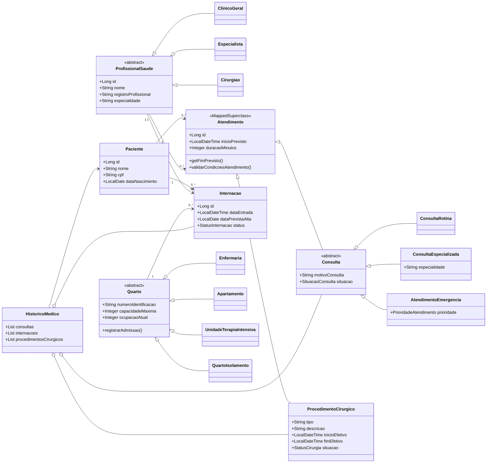

# Diagrama de classes — Sprints 1 e 2

O modelo usa herança `SINGLE_TABLE` para profissionais e consultas. `Atendimento` é uma `@MappedSuperclass`, portanto consultas e cirurgias continuam em tabelas separadas.

## Persistência

| Hierarquia | Estratégia | Tabela(s) |
|---|---|---|
| Profissionais | `SINGLE_TABLE`, discriminador `categoria` | `profissionais_saude` |
| Consultas | `SINGLE_TABLE`, discriminador `modalidade` | `consultas` |
| Atendimento | `@MappedSuperclass` | sem tabela própria |
| Cirurgias | entidade concreta | `procedimentos_cirurgicos` |
| Quartos | `SINGLE_TABLE`, discriminador `tipo` | `quartos` |

`AgendaService` é o colaborador de domínio que impede sobreposição de intervalos entre consultas e cirurgias do mesmo profissional.
