# Diagrama de Classes — Sprint 2

Trabalho Prático de Programação Modular — Sistema de Informação Hospitalar  
Curso de Engenharia de Software — PUC Minas

---

## 📊 Diagrama Visual (Mermaid)

```mermaid
classDiagram
    direction TB

    class SituacaoConsulta {
        <<enumeration>>
        AGENDADA
        CONFIRMADA
        EM_ATENDIMENTO
        CONCLUIDA
        CANCELADA
        NAO_COMPARECEU
    }

    class ModalidadeAtendimento {
        <<enumeration>>
        ROTINA
        ESPECIALIZADA
        EMERGENCIA
    }

    class PrioridadeAtendimento {
        <<enumeration>>
        BAIXA
        MODERADA
        ALTA
        CRITICA
    }

    class StatusInternacao {
        <<enumeration>>
        EM_ANDAMENTO
        ALTA
        CANCELADA
    }

    class StatusQuarto {
        <<enumeration>>
        DISPONIVEL
        OCUPADO
        EM_MANUTENCAO
    }

    class TipoQuarto {
        <<enumeration>>
        ENFERMARIA
        APARTAMENTO
        UTI
        ISOLAMENTO
        -String descricao
        -int capacidadeMinima
        -int capacidadeMaxima
        +novoQuarto() Quarto
    }

    class TipoIsolamento {
        <<enumeration>>
        CONTATO
        GOTICULAS
        AEROSSOIS
    }

    class Cpf {
        <<utility>>
        +isValido(String cpf)$ boolean
        +formatar(String cpf)$ String
        +somenteDigitos(String cpf)$ String
    }

    class Paciente {
        -Long id
        -String nome
        -String cpf
        -LocalDate dataNascimento
        -String telefone
        -String endereco
        -String email
        +getId() Long
        +getNome() String
        +setNome(String nome) void
        +getCpf() String
        +setCpf(String cpf) void
        +getDataNascimento() LocalDate
        +setDataNascimento(LocalDate dataNascimento) void
        +getTelefone() String
        +setTelefone(String telefone) void
        +getEndereco() String
        +setEndereco(String endereco) void
        +getEmail() String
        +setEmail(String email) void
        +atualizarDados(nome, nascimento, telefone, endereco, email) void
        +getIdade() Integer
        +isMenorDeIdade() boolean
    }

    class ProfissionalSaude {
        -Long id
        -String nome
        -String registroProfissional
        -String especialidade
        -String telefone
        -String email
        +getId() Long
        +getNome() String
        +setNome(String nome) void
        +getRegistroProfissional() String
        +setRegistroProfissional(String registro) void
        +getEspecialidade() String
        +setEspecialidade(String especialidade) void
        +getTelefone() String
        +setTelefone(String telefone) void
        +getEmail() String
        +setEmail(String email) void
    }

    class Quarto {
        <<abstract>>
        -Long id
        -String numeroIdentificacao
        -Integer andar
        -Integer capacidadeMaxima
        -Integer ocupacaoAtual
        -StatusQuarto situacao
        -Long versao
        +getTipo()* TipoQuarto
        +validarConfiguracao() void
        +registrarAdmissao(Internacao internacao) void
        #validarRequisitosDoTipo(Internacao internacao) void
        +temVagaDisponivel() boolean
        +incrementarOcupacao() void
        +decrementarOcupacao() void
        +getLeitosDisponiveis() int
        +colocarEmManutencao() void
        +liberarDaManutencao() void
        +alterarCapacidade(Integer nova) void
    }

    class Enfermaria {
        +getTipo() TipoQuarto
    }

    class Apartamento {
        -Boolean permiteAcompanhante
        +getTipo() TipoQuarto
        +getPermiteAcompanhante() Boolean
    }

    class UnidadeTerapiaIntensiva {
        +getTipo() TipoQuarto
        #validarRequisitosDoTipo(Internacao internacao) void
    }

    class QuartoIsolamento {
        -TipoIsolamento tipoIsolamento
        +getTipo() TipoQuarto
        +validarConfiguracao() void
        +getTipoIsolamento() TipoIsolamento
    }

    class Consulta {
        <<abstract>>
        -Long id
        -Paciente paciente
        -ProfissionalSaude profissional
        -LocalDateTime dataHora
        -String motivoConsulta
        -String observacoesMedicas
        -SituacaoConsulta situacao
        +getId() Long
        +getPaciente() Paciente
        +getProfissional() ProfissionalSaude
        +getDataHora() LocalDateTime
        +getSituacao() SituacaoConsulta
        +getModalidade() ModalidadeAtendimento
        +validarCondicoesAtendimento() void
        +transitarPara(SituacaoConsulta nova) void
        +confirmar() void
        +iniciarAtendimento() void
        +concluir(String obs) void
        +cancelar() void
        +registrarNaoComparecimento() void
    }

    class ConsultaRotina {
        +getModalidade() ModalidadeAtendimento
        +validarCondicoesAtendimento() void
    }

    class ConsultaEspecializada {
        -String especialidade
        +getEspecialidade() String
        +setEspecialidade(String esp) void
        +getModalidade() ModalidadeAtendimento
        +validarCondicoesAtendimento() void
    }

    class AtendimentoEmergencia {
        -PrioridadeAtendimento prioridade
        +getPrioridade() PrioridadeAtendimento
        +setPrioridade(PrioridadeAtendimento p) void
        +getModalidade() ModalidadeAtendimento
        +validarCondicoesAtendimento() void
        +isAguardandoAvaliacao() boolean
        +isEmAtendimento() boolean
        +isConcluido() boolean
    }

    class Internacao {
        -Long id
        -Paciente paciente
        -ProfissionalSaude profissional
        -Quarto quarto
        -LocalDateTime dataEntrada
        -LocalDate dataPrevistaAlta
        -LocalDateTime dataEfetivaAlta
        -String observacoes
        -StatusInternacao status
        +getId() Long
        +getPaciente() Paciente
        +getProfissional() ProfissionalSaude
        +getQuarto() Quarto
        +getDataEntrada() LocalDateTime
        +getDataPrevistaAlta() LocalDate
        +getDataEfetivaAlta() LocalDateTime
        +getObservacoes() String
        +getStatus() StatusInternacao
        +setStatus(StatusInternacao status) void
    }

    Consulta <|-- ConsultaRotina : herda
    Consulta <|-- ConsultaEspecializada : herda
    Consulta <|-- AtendimentoEmergencia : herda

    Paciente "1" -- "0..*" Consulta : possui
    ProfissionalSaude "1" -- "0..*" Consulta : realiza
    Paciente "1" -- "0..*" Internacao : internado em
    ProfissionalSaude "1" -- "0..*" Internacao : responsável
    Quarto "1" -- "0..*" Internacao : aloca

    Quarto <|-- Enfermaria : herda
    Quarto <|-- Apartamento : herda
    Quarto <|-- UnidadeTerapiaIntensiva : herda
    Quarto <|-- QuartoIsolamento : herda

    Consulta --> SituacaoConsulta
    Consulta --> ModalidadeAtendimento
    AtendimentoEmergencia --> PrioridadeAtendimento
    Internacao --> StatusInternacao
    Quarto --> StatusQuarto
    Quarto --> TipoQuarto
    QuartoIsolamento --> TipoIsolamento
    Paciente ..> Cpf : CPF validado por
```

---

## 📝 Código PlantUML

```plantuml
@startuml
skinparam classAttributeIconSize 0

enum SituacaoConsulta {
  AGENDADA
  CONFIRMADA
  EM_ATENDIMENTO
  CONCLUIDA
  CANCELADA
  NAO_COMPARECEU
}

enum ModalidadeAtendimento {
  ROTINA
  ESPECIALIZADA
  EMERGENCIA
}

enum PrioridadeAtendimento {
  BAIXA
  MODERADA
  ALTA
  CRITICA
}

enum StatusInternacao {
  EM_ANDAMENTO
  ALTA
  CANCELADA
}

enum StatusQuarto {
  DISPONIVEL
  OCUPADO
  EM_MANUTENCAO
}

enum TipoQuarto {
  ENFERMARIA
  APARTAMENTO
  UTI
  ISOLAMENTO
  - descricao: String
  - capacidadeMinima: int
  - capacidadeMaxima: int
  + novoQuarto(): Quarto
}

enum TipoIsolamento {
  CONTATO
  GOTICULAS
  AEROSSOIS
}

class Cpf <<utility>> {
  + {static} isValido(cpf: String): boolean
  + {static} formatar(cpf: String): String
  + {static} somenteDigitos(cpf: String): String
}

class Paciente {
  - id: Long
  - nome: String
  - cpf: String
  - dataNascimento: LocalDate
  - telefone: String
  - endereco: String
  - email: String
  + getId(): Long
  + getNome(): String
  + setNome(nome: String): void
  + getCpf(): String
  + setCpf(cpf: String): void
  + getDataNascimento(): LocalDate
  + setDataNascimento(data: LocalDate): void
  + getTelefone(): String
  + setTelefone(telefone: String): void
  + getEndereco(): String
  + setEndereco(endereco: String): void
  + getEmail(): String
  + setEmail(email: String): void
  + atualizarDados(nome: String, nascimento: LocalDate, telefone: String, endereco: String, email: String): void
  + getIdade(): Integer
  + isMenorDeIdade(): boolean
}

class ProfissionalSaude {
  - id: Long
  - nome: String
  - registroProfissional: String
  - especialidade: String
  - telefone: String
  - email: String
  + getId(): Long
  + getNome(): String
  + setNome(nome: String): void
  + getRegistroProfissional(): String
  + setRegistroProfissional(registro: String): void
  + getEspecialidade(): String
  + setEspecialidade(esp: String): void
  + getTelefone(): String
  + setTelefone(telefone: String): void
  + getEmail(): String
  + setEmail(email: String): void
}

abstract class Quarto {
  - id: Long
  - numeroIdentificacao: String
  - andar: Integer
  - capacidadeMaxima: Integer
  - ocupacaoAtual: Integer
  - situacao: StatusQuarto
  - versao: Long
  + {abstract} getTipo(): TipoQuarto
  + validarConfiguracao(): void
  + registrarAdmissao(internacao: Internacao): void
  # validarRequisitosDoTipo(internacao: Internacao): void
  + temVagaDisponivel(): boolean
  + incrementarOcupacao(): void
  + decrementarOcupacao(): void
  + getLeitosDisponiveis(): int
  + colocarEmManutencao(): void
  + liberarDaManutencao(): void
  + alterarCapacidade(nova: Integer): void
}

class Enfermaria {
  + getTipo(): TipoQuarto
}

class Apartamento {
  - permiteAcompanhante: Boolean
  + getTipo(): TipoQuarto
  + getPermiteAcompanhante(): Boolean
}

class UnidadeTerapiaIntensiva {
  + getTipo(): TipoQuarto
  # validarRequisitosDoTipo(internacao: Internacao): void
}

class QuartoIsolamento {
  - tipoIsolamento: TipoIsolamento
  + getTipo(): TipoQuarto
  + validarConfiguracao(): void
  + getTipoIsolamento(): TipoIsolamento
}

abstract class Consulta {
  - id: Long
  - paciente: Paciente
  - profissional: ProfissionalSaude
  - dataHora: LocalDateTime
  - motivoConsulta: String
  - observacoesMedicas: String
  - situacao: SituacaoConsulta
  + getId(): Long
  + getPaciente(): Paciente
  + getProfissional(): ProfissionalSaude
  + getDataHora(): LocalDateTime
  + getSituacao(): SituacaoConsulta
  + getModalidade(): ModalidadeAtendimento
  + validarCondicoesAtendimento(): void
  + transitarPara(nova: SituacaoConsulta): void
  + confirmar(): void
  + iniciarAtendimento(): void
  + concluir(obs: String): void
  + cancelar(): void
  + registrarNaoComparecimento(): void
}

class ConsultaRotina {
  + getModalidade(): ModalidadeAtendimento
  + validarCondicoesAtendimento(): void
}

class ConsultaEspecializada {
  - especialidade: String
  + getEspecialidade(): String
  + setEspecialidade(esp: String): void
  + getModalidade(): ModalidadeAtendimento
  + validarCondicoesAtendimento(): void
}

class AtendimentoEmergencia {
  - prioridade: PrioridadeAtendimento
  + getPrioridade(): PrioridadeAtendimento
  + setPrioridade(p: PrioridadeAtendimento): void
  + getModalidade(): ModalidadeAtendimento
  + validarCondicoesAtendimento(): void
  + isAguardandoAvaliacao(): boolean
  + isEmAtendimento(): boolean
  + isConcluido(): boolean
}

class Internacao {
  - id: Long
  - paciente: Paciente
  - profissional: ProfissionalSaude
  - quarto: Quarto
  - dataEntrada: LocalDateTime
  - dataPrevistaAlta: LocalDate
  - dataEfetivaAlta: LocalDateTime
  - observacoes: String
  - status: StatusInternacao
  + getId(): Long
  + getPaciente(): Paciente
  + getProfissional(): ProfissionalSaude
  + getQuarto(): Quarto
  + getDataEntrada(): LocalDateTime
  + getDataPrevistaAlta(): LocalDate
  + getDataEfetivaAlta(): LocalDateTime
  + getObservacoes(): String
  + getStatus(): StatusInternacao
  + setStatus(status: StatusInternacao): void
}

Consulta <|-- ConsultaRotina
Consulta <|-- ConsultaEspecializada
Consulta <|-- AtendimentoEmergencia

Paciente "1" -- "0..*" Consulta : possui >
ProfissionalSaude "1" -- "0..*" Consulta : realiza >
Paciente "1" -- "0..*" Internacao : internado em >
ProfissionalSaude "1" -- "0..*" Internacao : responsável >
Quarto "1" -- "0..*" Internacao : aloca >

Quarto <|-- Enfermaria
Quarto <|-- Apartamento
Quarto <|-- UnidadeTerapiaIntensiva
Quarto <|-- QuartoIsolamento

Consulta --> SituacaoConsulta
Consulta --> ModalidadeAtendimento
AtendimentoEmergencia --> PrioridadeAtendimento
Internacao --> StatusInternacao
Quarto --> StatusQuarto
Quarto --> TipoQuarto
QuartoIsolamento --> TipoIsolamento
Paciente ..> Cpf : CPF validado por

@enduml
```

---

## 📌 Detalhamento dos Relacionamentos e Multiplicidades

1. **Paciente — Consulta (1 para 0..*)**:
   * Um `Paciente` pode ter 0 ou várias consultas registradas em seu histórico.
   * Toda `Consulta` pertence obrigatoriamente a exatamente 1 paciente.

2. **ProfissionalSaude — Consulta (1 para 0..*)**:
   * Um `ProfissionalSaude` pode atender 0 ou várias consultas ao longo do tempo.
   * Toda `Consulta` é conduzida por exatamente 1 profissional responsável.

3. **Herança de Modalidades de Atendimento**:
   * `Consulta` é a classe base abstrata/generalizada.
   * `ConsultaRotina`, `ConsultaEspecializada` e `AtendimentoEmergencia` estendem `Consulta`, implementando regras de validação polimórficas (`validarCondicoesAtendimento()`).

4. **Paciente — Internacao (1 para 0..*)**:
   * Um `Paciente` pode possuir 0 ou mais internações no seu histórico clínico.
   * Cada registro de `Internacao` refere-se a exatamente 1 paciente.

5. **Quarto — Internacao (1 para 0..*)**:
   * Um `Quarto` pode receber múltiplas internações ao longo de sua vida útil, respeitando a capacidade máxima simultânea (`ocupacaoAtual <= capacidadeMaxima`).
   * Cada `Internacao` está associada a exatamente 1 quarto e a 1 profissional responsável.

6. **Herança dos Tipos de Quarto**:
   * `Quarto` é a classe base abstrata; `Enfermaria` (2 a 8 leitos), `Apartamento` (1 a 2, com `permiteAcompanhante`), `UnidadeTerapiaIntensiva` (1 a 10) e `QuartoIsolamento` (1 leito, com `TipoIsolamento`) a estendem.
   * `registrarAdmissao()` segue o padrão *Template Method*: a classe base verifica manutenção e vagas, e cada subclasse pode acrescentar requisitos em `validarRequisitosDoTipo()` (a UTI exige justificativa clínica).
   * `validarConfiguracao()` é polimórfico: a base valida a faixa de capacidade do tipo e `QuartoIsolamento` exige também o tipo de isolamento.
   * O enum `TipoQuarto` funciona como fábrica (`novoQuarto()`), usada pelo `QuartoService` para instanciar a subclasse correta a partir do tipo recebido na API.
